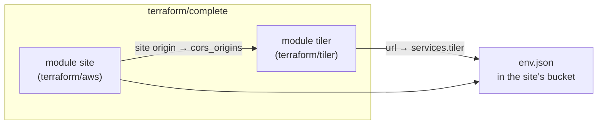

# Website and tiler together

`terraform/complete/` deploys everything the website needs in one
configuration: the static site ([`terraform/aws`](./deploy)) and the
[tiler](/tiler/) its cloud-only datasets are read from
([`terraform/tiler`](/tiler/infrastructure)), wired to each other.

## The wiring <Badge type="warning" text="decision" />

::: code-group
<<< @/../terraform/complete/main.tf#wiring [terraform/complete/main.tf#wiring]
<<< @/../terraform/aws/main.tf#env-json [terraform/aws/main.tf#env-json]
:::

- **The website finds the tiler.** The site module takes an optional `env`:
  the contents of the website's `env.json`. `complete` passes the
  repository's `website/env.json` with `services.tiler` set to the tiler's
  URL, and the site module writes it to the bucket (`Cache-Control:
  no-cache`). Its `deploy_commands` then sync `website/` with `--exclude
  env.json`, so a deploy cannot put the repository's `"tiler": null` back.
  Without `env`, nothing changes: `website/env.json` is deployed as is.
- **The tiler only serves the website.** Its CORS origins are the website's
  origin plus `extra_cors_origins` (e.g. `http://localhost:8000` to try a
  local copy of the site against it). With a restricted list, the tiler's
  CloudFront cache key includes the `Origin` header.

There is no dependency cycle: the tiler needs the site's CloudFront domain,
and the site's `env.json` object needs the tiler's URL, but the
distribution itself does not depend on `env`.

::: tip Why not one bigger module
The two modules stay usable on their own (the website without any tiler,
the tiler for any map client). `complete` only adds the coupling. The site
module still configures its own provider (it is also used as a root
configuration, see [Deployment](./deploy)); the tiler's providers come from
the caller, whose `default_tags` tag the tiler's resources, while the site's
are tagged from `name`, `environment` and `extra_tags`.
:::

## Using it

A caller passes the tiler's four providers and the tiler's secrets, as in
the test example:

::: code-group
<<< @/../terraform/complete/examples/test/main.tf#providers [examples/test/main.tf#providers]
:::

Then deploy `website/` with the `deploy_commands` output, as for the site
module alone; `env.json` is already in place.

## Tests

`tofu test` in `terraform/complete` plans the configuration with mocked
providers. The site module's own providers cannot be mocked, so its call is
replaced by fixed outputs (`override_module`); the assertions check the
wiring:

::: code-group
<<< @/../terraform/complete/tests/plan.tftest.hcl#wiring-asserts [tests/plan.tftest.hcl#wiring-asserts]
:::

`scripts/aws-tests/complete.sh` deploys the test example in AWS (every
resource named `ycgs-test-all-<run id>` and tagged `ycgs:purpose=test`),
deploys `website/` with the site's deploy user and role, and checks:

- the served `env.json` points at this tiler, keeps the repository's other
  settings, survives the deploy, and is not cached;
- the tiler answers CORS for the website's origin and `extra_cors_origins`,
  and for no other;
- the website ([the site test's checks](./deploy)) and the tiler
  (`tiler-smoke.sh`).

Then it destroys everything and sweeps, like the other
[AWS tests](/tiler/operations#on-aws-the-test-deployment).
