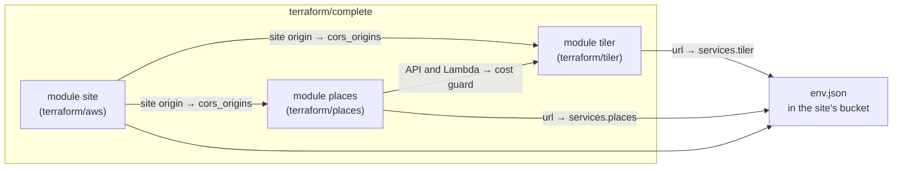

# Website and tiler together

`terraform/complete/` deploys everything the website needs in one
configuration: the static site ([`terraform/aws`](./deploy)), the
[tiler](/tiler/) its cloud-only datasets are read from
([`terraform/tiler`](/tiler/infrastructure)) and its
[place search](/website/search#the-places-api) (`terraform/places`), wired
to each other.

## The wiring <Badge type="warning" text="decision" />

::: code-group
<<< @/../terraform/complete/main.tf#wiring [terraform/complete/main.tf#wiring]
<<< @/../terraform/aws/main.tf#env-json [terraform/aws/main.tf#env-json]
:::

- **The website finds the tiler.** The site module takes an optional `env`:
  the contents of the website's `env.json`. `complete` passes the
  repository's `website/env.json` with `services.tiler` set to the tiler's
  URL, and the site module writes it to the bucket (`Cache-Control:
  no-cache`). Its `deploy_commands` then sync `website/` with `--exclude
  env.json`, so a deploy cannot put the repository's `"tiler": null` back.
  Without `env`, nothing changes: `website/env.json` is deployed as is.
- **The place search** (`places = true` by default) gets the same CORS
  origins, goes into `env.json` as `services.places`, and is watched and
  stopped by the tiler's cost guard (`guard_extra_apis`,
  `guard_extra_functions`); see [Cost](/website/search#cost).
- **The tiler only serves the website.** Its CORS origins are the website's
  origin plus `extra_cors_origins` (e.g. `http://localhost:8000` to try a
  local copy of the site against it). With a restricted list, the tiler's
  CloudFront cache key includes the `Origin` header.

There is no dependency cycle: the tiler needs the site's CloudFront domain,
and the site's `env.json` object needs the tiler's URL, but the
distribution itself does not depend on `env`.

::: tip Why not one bigger module
The two modules stay usable on their own (the website without any tiler,
the tiler for any map client). `complete` only adds the coupling. The site
module still configures its own provider (it is also used as a root
configuration, see [Deployment](./deploy)); the tiler's providers come from
the caller, whose `default_tags` tag the tiler's resources, while the site's
are tagged from `name`, `environment` and `extra_tags`.
:::

## Using it

A caller passes the tiler's four providers and the tiler's secrets, as in
the test example:

::: code-group
<<< @/../terraform/complete/examples/test/main.tf#providers [examples/test/main.tf#providers]
:::

Then deploy `website/` with the `deploy_commands` output, as for the site
module alone; `env.json` is already in place. Besides the site module's
outputs, `tiler_url`, `places_url` (null with `places = false`) and `env`
give the wired URLs, `tiler_deployments` each region's function, API
endpoint and lookup table, and `tiler_guard` the cost guard's alert topic,
kill switch and budget.

### Settings

The tiler, place search and cost guard are set through prefixed variables,
passed on to their modules (`variables.tf`):

| Variable | Default | Meaning |
|---|---|---|
| `tiler_lambda_memory` | `{ nasa = 3008, noaa = 2048, ecmwf = 2048 }` | Lambda memory (MB) per regional deployment; CPU scales with it |
| `tiler_reserved_concurrency` | `{ nasa = 60, noaa = 60, ecmwf = 30 }` | Cap on concurrent executions: ~$17/h with every instance busy ([Cost guard](/tiler/guard#reserved-concurrency)) |
| `tiler_snap_start` | `true` for all three | SnapStart per deployment. Each published version's snapshot is billed around the clock (~$8/month per 2 GB), used or not; turn it off for a rarely used deployment, whose first request after a pause then pays a full cold start. Give all three keys |
| `tiler_keep_versions` | `1` | Published Lambda versions kept per deployment, the live one included. With 1, rolling back means redeploying an earlier ref ([Version pruning](/tiler/infrastructure#version-pruning)) |
| `tiler_throttling_rate_limit`, `tiler_throttling_burst_limit` | `100`, `200` | API Gateway requests per second and burst, per deployment |
| `tiler_origin_shield` | `true` | CloudFront Origin Shield in front of each region ([CloudFront](/tiler/cloudfront)) |
| `tiler_image_platform` | `"linux/arm64"` | Docker platform of the Lambda image |
| `places` | `true` | Deploy the place search |
| `places_throttling_rate_limit`, `places_throttling_burst_limit` | `5`, `10` | Place searches per second for all users together, and burst; bounds the Places bill ([Cost](/website/search#cost)) |
| `guard` | `true` | The cost guard: traffic alarms, kill switch, budget ([Cost guard](/tiler/guard)) |
| `alert_emails` | `[]` | Addresses for warnings, kill reports and budget alerts |
| `guard_budget_usd` | `50` | Monthly budget backstop (USD): email at 80% spent or forecast 100%, kill at 100%; `null`: no budget |
| `guard_budget_filters` | the app's services, account-wide | Budget cost filters |

## Tests

`tofu test` in `terraform/complete` plans the configuration with mocked
providers. The site module's own providers cannot be mocked, so its call is
replaced by fixed outputs (`override_module`); the assertions check the
wiring:

::: code-group
<<< @/../terraform/complete/tests/plan.tftest.hcl#wiring-asserts [tests/plan.tftest.hcl#wiring-asserts]
:::

The same run checks that the cost guard is on and `env.json` points
`services.places` at the place search; a second run, `no_places`, checks
that `places = false` creates no place search and sets `services.places` to
null.

`scripts/aws-tests/complete.sh` deploys the test example in AWS (every
resource named `ycgs-test-all-<run id>` and tagged `ycgs:purpose=test`),
deploys `website/` with the site's deploy user and role, and checks:

- the served `env.json` points at this tiler, keeps the repository's other
  settings, survives the deploy, and is not cached;
- the tiler answers CORS for the website's origin and `extra_cors_origins`,
  and for no other;
- `env.json`'s `services.places` is this place search, which allows the
  website's origin, refuses others, and suggests New Haven for "New Haven";
- the website ([the site test's checks](./deploy#test)) and the tiler
  (`tiler-smoke.sh`).

Then it destroys everything and sweeps, like the other
[AWS tests](/tiler/operations#on-aws-the-test-deployment).
