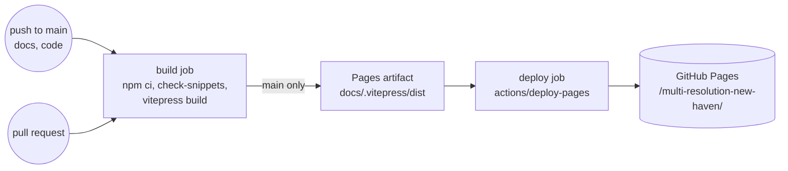

# Documentation site

These pages are a [VitePress](https://vitepress.dev/) site in `docs/`,
published to GitHub Pages at
<https://ycgs-lab.github.io/multi-resolution-new-haven/> by a GitHub Actions
workflow. The map viewer itself (Bowerbird, `website/`) is deployed
separately, to S3 and CloudFront ([Deployment](./deploy)).

```sh
just docs                          # http://localhost:5173/, reloads on save
cd docs && npm run build           # snippet check + static build in docs/.vitepress/dist/
```



## Code snippets <Badge type="tip" text="standard" />

Most pages show code with VitePress snippet imports,
`<<< @/../path/to/file#region`, which include the lines between
`#region name` and `#endregion name` comments in that file. VitePress shows
the whole file when a region is missing, so `npm run build` first runs
`scripts/check-snippets.mjs`: every imported file must exist and every named
region must appear exactly once. It also lists regions no page uses.

::: code-group
<<< @/package.json [docs/package.json]
:::

Because pages include code from `website/`, `tiler/`, `terraform/`,
`scripts/` and the `justfile`, a change to any of them rebuilds the site.
VitePress fails the build on a dead link between pages (links to
`localhost` are allowed: some pages give local URLs).

## Publishing <Badge type="warning" text="decision" />

::: code-group
<<< @/../.github/workflows/docs.yml [.github/workflows/docs.yml]
:::

- **Triggers.** Pushes to `main` that touch the docs or any code they
  include build and deploy; pull requests only build, so a broken snippet
  or link shows up before merging; the workflow can also be run by hand.
- **Base path.** A project's Pages site is served from `/<repo>/`, and
  VitePress must know that prefix to write its links and assets.
  `config.mts` reads it from `DOCS_BASE`, which the workflow sets from
  `actions/configure-pages` (`base_path`). Locally `DOCS_BASE` is unset and
  the site is served at `/`.
- **Permissions.** The build job can only read the repository; only the
  deploy job gets `pages: write` and `id-token: write`, which
  `actions/deploy-pages` needs.
- **Node.** The version in `.node-version`, as for the
  [vendored bundle](./vendor).

To check the published layout locally:

```sh
cd docs
export DOCS_BASE=/multi-resolution-new-haven/   # preview reads the config too
npm run build
npx vitepress preview         # http://localhost:4173/multi-resolution-new-haven/
```

### One-time setup

In the repository's **Settings → Pages → Build and deployment**, set
**Source** to **GitHub Actions**. Until then the deploy job fails. (Pages
on a private repository needs a GitHub plan that allows it.)
