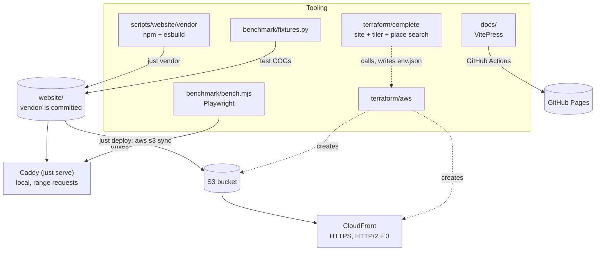

# Build, deploy, test

The site needs no build step to run: its JavaScript runs as written. The
pieces around it do have tooling:

| Piece | What | Page |
|---|---|---|
| Vendored bundle | deck.gl + deck.gl-raster as one committed ES module (and zarrita as a second), rebuilt with `just vendor` | [Vendored bundle](./vendor) |
| Local server | Caddy (`just serve`): `website/` over HTTP on localhost, with range requests | [Local development](./local) |
| Hosting | Terraform: private S3 bucket behind CloudFront, plus a minimal deploy identity; `just deploy` | [Deployment](./deploy) |
| Website and tiler | `terraform/complete`: the hosting, the tiler and the place search in one configuration, wired to each other | [Website and tiler together](./complete) |
| Documentation | These pages: VitePress in `docs/`, published to GitHub Pages by a GitHub Actions workflow | [Documentation site](./docs-site) |
| Tests | Credential-free fixture COGs and a before/after benchmark in headless Chromium | [Fixtures and benchmark](./benchmark) |

## Tests

The website's JavaScript has no unit tests. The renderer was checked by
comparing screenshots against the previous version product by product, and
is measured by the benchmark. The rest is tested:

- **Tiler:** `pytest` in `tiler/tests`
  ([Running and testing](/tiler/operations#tests-and-checks)).
- **Terraform:** `tofu test` in `terraform/tiler` and `terraform/complete`
  plans each configuration with mocked providers and checks it
  ([plan tests](/tiler/infrastructure#plan-tests),
  [wiring](./complete#tests)).
- **AWS:** `scripts/aws-tests/*.sh` deploy tagged test copies in AWS, check
  them, destroy them and prove nothing is left: the site
  ([Deployment](./deploy#test)), the site with the tiler
  ([Website and tiler together](./complete#tests)) and the tiler alone
  ([on AWS](/tiler/operations#on-aws-the-test-deployment)).
- **Docs:** the docs workflow also builds every pull request that touches
  the docs or the code they include, so a broken snippet or a dead link
  fails before merging ([Documentation site](./docs-site#publishing)).
