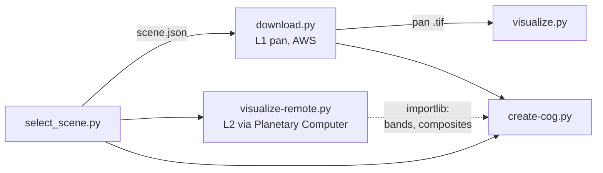

# Optical imagery

Four sources, from 7.6 cm aerial photography to 30 m Landsat, all read live
by the website for the date the user picks (see [Time, live data and
credentials](../../website/time)): the CT orthoimagery from Connecticut's
image service of each flight year, NAIP and Landsat from the Microsoft
Planetary Computer, Planet from its tile service with the user's own API
key. Only the Landsat panchromatic band is still stored locally.

## CT orthoimagery

**Statewide flights 1934-2023; the figures use 2023: 7.6 cm (3 in), 4 bands,
leaf-off, flown 2023-03-27 to 04-13.** Scripts: `ct-ortho-2023/visualize-remote.py`
(figures), `ct-ortho/website-layers.py` (website, all years).

- **Figures** request raw 8-bit bands from the CT ECO `Ortho_2023`
  ImageServer through [`arcgis_export_image`](../remote#arcgis-exportimage-and-wms).
  They use the same oversampling as NAIP (below) and a pooled percentile
  stretch with gamma 1.4, brighter than NAIP's 1.15 because leaf-off
  vegetation is dark. Products: true color (bands 0, 1, 2) and color infrared
  (3, 0, 1).
- **Website**: an `arcgis_source` per product with server-side band
  reordering, shown unstretched (`identity`), whose `variants` switch the
  service with the selected flight year (a drop-down: 1934, 1990 and 2004 in
  black and white, 2008 color, 2012-2023 color and near infrared). No copy
  of the multi-gigapixel mosaics is made.

::: code-group
<<< @/../scripts/ct-ortho/website-layers.py#ortho-years [scripts/ct-ortho/website-layers.py#ortho-years]
:::
- The service has no per-tile dates, so the flight window is a constant
  taken from CT ECO's metadata page.

## NAIP

**0.3-1 m, 4 bands, every 2-3 years per state since 2010; the figures use
2023 (0.3 m, flown 2023-07-05 to 07-11).** Scripts: `visualize-remote.py`
(figures, CT ECO `NAIP_2023`), `website-layers.py` (website, Planetary
Computer).

::: warning Design decision: the Planetary Computer for the website
CT ECO serves Connecticut's NAIP years as separate services. The Planetary
Computer's `naip` collection has every year for the contiguous US, with a
STAC API that says which years cover the area in view, so the website uses
it (a year drop-down) and works beyond Connecticut. The figures keep CT ECO.
:::

::: code-group
<<< @/../scripts/naip/visualize-remote.py#oversample-block-average [scripts/naip/visualize-remote.py#oversample-block-average]
:::

The figures request twice the view's pixel density and average 2 × 2 blocks.
The server reads its overview pyramid bilinearly; averaging a 2× request
avoids aliasing at the view's pixel size. Flight dates come from the catalog
names of the tiles covering each view (`/query`, USDA naming `..._YYYYMMDD_...`).

::: code-group
<<< @/../scripts/naip/website-layers.py#naip-live-source [scripts/naip/website-layers.py#naip-live-source]
:::

The website shows the server's 8-bit values as PNG tiles of the year's
mosaic (`fmt="png"`), unstretched.

## Planet

**4.8 m Mercator (≈3.6 m ground), monthly basemaps; the figures use July
2026.** Scripts: `visualize-remote.py` (figures), `website-layers.py`
(website).

The tiles come from Planet's basemap XYZ service at zoom 15, its native
level; Planet would only upsample at finer zooms. The figures use average
resampling for the greater view (native finer than 5.6 m) and nearest
neighbor for the central one, so blocks show. The API key is never printed:
request errors are re-raised with the key replaced by `<planet_api_key>`.

::: code-group
<<< @/../scripts/planet/website-layers.py#planet-live-source [scripts/planet/website-layers.py#planet-live-source]
:::

::: warning Design decision: the user's own key, in the browser
The website reads Planet's tiles live, with the API key the user enters in
the Credentials dialog (kept in their browser, sent only to Planet). The
months are the `global_monthly_YYYY_MM_mosaic` basemaps that key can read
(Basemaps API). Without a key the dataset is locked. (An earlier version
stored one month as a local COG to keep the project's key out of the
browser.)
:::

## Landsat 8

**30 m surface reflectance and temperature (Collection 2 Level-2), 15 m
panchromatic (Level-1); the figures use 2024-08-27, the website any date
since 2013.** Scripts: `select_scene.py`, `scene.py`, `download.py`,
`visualize.py`, `visualize-remote.py`, `website-layers.py`, `create-cog.py`.

`scene.py` holds the dataset name and loads `scene.json`, the shared state
written by `select_scene.py`.

### Scene selection <Badge type="warning" text="decision" />

::: code-group
<<< @/../scripts/landsat/select_scene.py#scene-selection-criteria [scripts/landsat/select_scene.py#scene-selection-criteria]
<<< @/../scripts/landsat/select_scene.py#view-cloud-check [scripts/landsat/select_scene.py#view-cloud-check]
:::

It searches the Planetary Computer STAC for Landsat 8 scenes with under 5%
scene cloud, newest first, in the growing season (May 20 – Sep 30). It takes
the first whose footprint contains both views and whose `QA_PIXEL` band,
read over the padded views only, shows less than 0.1% cloud, cirrus or
shadow and no fill. Scene-level cloud cover is too coarse: a 3%-cloudy scene
can have its clouds right over New Haven.

### Level-1 panchromatic band <Badge type="warning" text="decision" />

Level-2 products have no panchromatic band. `find_l1` finds the matching
Level-1 scene in the USGS LandsatLook STAC (same date, path and row) and
records its S3 location:

::: code-group
<<< @/../scripts/landsat/select_scene.py#find-level1-pan [scripts/landsat/select_scene.py#find-level1-pan]
<<< @/../scripts/landsat/download.py#requester-pays-window [scripts/landsat/download.py#requester-pays-window]
:::

Level-1 data are only in the AWS requester-pays bucket, so `download.py`
needs AWS keys. It reads only the padded window (a few hundred KB), with
`GDAL_DISABLE_READDIR_ON_OPEN` so GDAL does not list the bucket.

### Level-2 bands and composites

::: code-group
<<< @/../scripts/landsat/visualize-remote.py#band-composites [scripts/landsat/visualize-remote.py#band-composites]
<<< @/../scripts/landsat/visualize-remote.py#titiler-chunked-fetch [scripts/landsat/visualize-remote.py#titiler-chunked-fetch]
:::

The Planetary Computer's data API (titiler) reprojects and crops the bands
server-side, straight onto each view's EPSG:3857 grid, with nearest
neighbor. Full-view 7-band responses (>100 MB) drop, so the view is fetched
in chunks with retries. DNs (digital numbers, the stored integers) are
converted with the Collection 2 scale factors: reflectance =
DN × 2.75e-5 − 0.2, temperature = DN × 0.00341802 + 149 K.

::: warning Design decision: true color shares one stretch
Each composite stretches each band between its 1st and 99th percentile over
the greater view, except true color: its three bands share one range. That
keeps the color balance (gray stays gray), at the cost of less contrast.
:::

### Website: live Level-2 mosaics

::: code-group
<<< @/../scripts/landsat/website-layers.py#landsat-live-source [scripts/landsat/website-layers.py#landsat-live-source]
<<< @/../scripts/landsat/website-layers.py#live-stretches [scripts/landsat/website-layers.py#live-stretches]
:::

The website lists the Landsat 8-9 acquisition dates over the area in view
from the Planetary Computer STAC API (with each scene's cloud cover, for
the "max cloud cover" filter, 20% by default), and reads raw tiles of the
selected date, or of a window of dates mosaicked with the latest, median or
average pixel, from its data API. The scale factors turn the DNs into
reflectance and °C in the browser; the five products are render specs as
before, with fixed stretches (per-scene percentiles do not carry over to
arbitrary dates).

::: warning Design decision: scene cloud cover, not a per-pixel cloud mask
The filter uses each scene's `eo:cloud_cover`, which can miss clouds over
New Haven (as `select_scene.py` notes). The data API cannot mask pixels with
`QA_PIXEL` before mosaicking (an expression with bit masks fails on the
server), so for cloud-free images use a window with the median pixel.
:::

The Level-1 panchromatic band is not on the Planetary Computer and needs
AWS requester-pays keys, so `create-cog.py` still stores the one scene's
15 m pan band as a COG (dataset `landsat-pan`), shown as a single
pre-built timestep.
