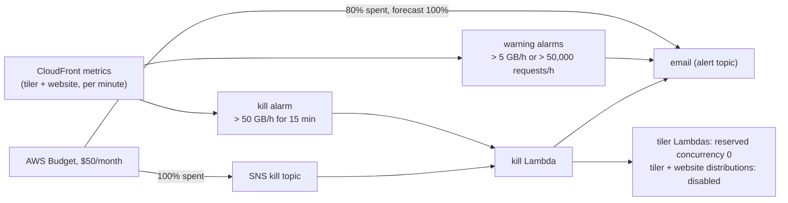

# Cost guard (`guard.tf`, reserved concurrency)

The tiler is public and has no authentication, so its bill depends on what
anyone requests. Two limits keep that bounded:

- **Reserved concurrency** caps what the tiler's Lambdas can spend.
- **The cost guard** watches what no Lambda limit sees, the requests and
  transfer CloudFront serves from its cache, and shuts everything down if
  they run far above normal.

## Reserved concurrency

Each regional deployment is one Lambda function in one region, and
`reserved_concurrency` caps how many copies of it run at once (one request
each). Requests beyond the cap are rejected without running, so they cost
nothing; CloudFront doesn't cache the error and the website retries once.
The cap also reserves that capacity out of the region's account-wide
limit (1,000), so the tiler and the account's other functions can't starve
each other.

| Deployment | Memory | Default cap | Most it can spend |
|---|---|---|---|
| nasa (us-west-2) | 2.9 GB | 60 | ~$8.50/h |
| noaa (us-east-1) | 2 GB | 60 | ~$5.80/h |
| ecmwf (eu-central-1) | 2 GB | 30 | ~$2.90/h |
| **total** | | **150** | **~$17/h** (~$20/h with API Gateway, logs and the shield at that load) |

That is with every instance busy around the clock. At ~3 s per render, 60
instances serve ~20 fresh tiles a second per region; cached tiles don't
count.

API Gateway's throttle (`throttling_rate_limit`, `throttling_burst_limit`)
is separate: it limits requests *arriving* per second (all callers
together; over the limit, API Gateway answers 429 without invoking Lambda),
while concurrency limits work *in progress*, which is what Lambda bills.

## The guard

| Part | Threshold (variable) | Action |
|---|---|---|
| Warning, bytes | 5 GB/h (`guard_warn_bytes_per_hour`, ~$0.43/h of transfer) in any 5-minute period | email |
| Warning, requests | 50,000/h (`guard_warn_requests_per_hour`) in any 5-minute period | email |
| Kill | 50 GB/h (`guard_kill_bytes_per_hour`, ~$4.25/h) for 15 minutes (`guard_kill_minutes`) | kill Lambda, email |
| Budget | $50/month (`guard_budget_usd`): 80% spent or forecast over | email |
| Budget | 100% spent | kill Lambda (through SNS), email |

The alarms sum the CloudFront metrics of the tiler's distribution and
`guard_extra_distribution_ids` (in `terraform/complete`, the website's) in
5-minute periods; hourly thresholds are converted per period. CloudFront
metrics are only in us-east-1, so the guard lives there (the module checks
that its default provider is us-east-1).

::: warning Design decision: alarms on usage, a budget only as backstop
Billing data reaches Budgets hours late (often 8-24 h), which at a flood's
rate is a large bill before it fires. CloudFront's metrics arrive within
minutes, and transfer cost is bytes x $0.085/GB, so an alarm on bytes is a
near-real-time spend alarm. The budget catches what the alarms don't: a
slow leak that never crosses an hourly threshold.
:::

::: warning The budget counts more than this deployment
This is a linked account in an AWS Organization, which can't use
cost-allocation tags unless the management account activates them. So by
default the budget filters by service (CloudFront, Lambda, API Gateway,
DynamoDB) **account-wide**: every deployment of this app, and anything
else in the account using those services. With the `Service` tag activated,
set `guard_budget_filters = { TagKeyValue = ["user:Service$<name>-tiler", ...] }`
for a per-deployment budget.
:::

### The kill switch

::: code-group
<<< @/../terraform/tiler/guard/kill.py [guard/kill.py]
:::

It sets the three tiler functions' reserved concurrency to 0 (no more
renders, at once) and disables the distributions (no more requests or
transfer; CloudFront takes ~5-15 minutes to stop serving). Each step is
tried even if another fails, and the report goes to the alert topic.

- **Test it** without changing anything:
  `aws lambda invoke --region us-east-1 --function-name <name>-tiler-cost-kill --payload '{"dry_run": true}' --cli-binary-format raw-in-base64-out out.json`
- **Trigger it** by hand: the same with `'{}'`.
- **Restore**: `tofu apply` in the deployment's stack. OpenTofu sees the
  drift and puts back the configured concurrency and `enabled = true`
  (distributions take ~5-15 minutes to come back). An apply during an
  incident undoes the kill too, so find the cause first.

### Email

`alert_emails` subscribe to the alert topic; AWS sends each address a
confirmation link, and nothing arrives until it is clicked. Budget emails
go to the same addresses directly.

### Cost

Under $1/month: three alarms at $0.10 per metric per month (each sums two
distributions' metrics: ~$0.60), the kill Lambda only when it runs, and SNS
and the budget within their free tiers.
