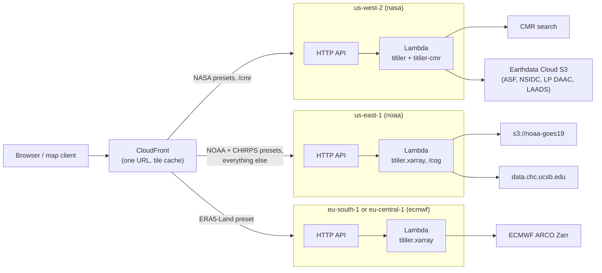
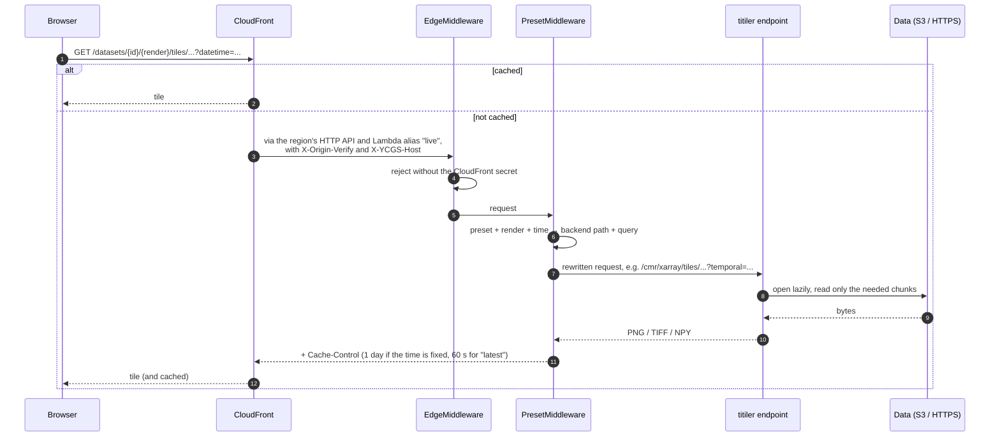

# Tiler: overview

The tiler renders map tiles on request from scientific raster data that a
browser cannot read itself: NetCDF and HDF5 granules in NASA's and NOAA's
S3 buckets, a Zarr store behind an API key, COGs served without CORS
headers. The [map viewer](/website/time#this-repository-s-tiler) uses it for
the live, cloud-only datasets (SMAP, Black Marble, GOES LST, CHIRPS); its
other presets (NISAR, HLS, GOES imagery, ERA5-Land, ASTER) can be used by
any map client.

It is a deployment of [titiler](https://developmentseed.org/titiler/), a
Python dynamic tiling server, with two extensions:

- [titiler-cmr](https://github.com/developmentseed/titiler-cmr) finds NASA
  granules through NASA's search catalog ([CMR](./glossary#cmr)) and reads
  them where they are.
- [titiler.xarray](https://developmentseed.org/titiler/packages/xarray/)
  reads Zarr and NetCDF by URL through [xarray](./glossary#xarray).

On top of them sits a thin layer of our own: **dataset presets**. A client
asks for a dataset by name, a named **render** (band combination and color
scaling) and optionally a time; the service turns that into the backend
request.

```
GET /datasets/nisar-gcov/balanced/tiles/WebMercatorQuad/12/1218/1531.png?datetime=2026-07-17
GET /datasets/goes19-abi/ir-clean/tiles/WebMercatorQuad/6/19/23.png              # latest scan
GET /datasets/era5-land-t2m/diff/tiles/WebMercatorQuad/6/19/23.png?datetime=2026-07-20T09:00&datetime2=2026-07-20T17:00
GET /datasets/smap-l4/raw/tiles/WebMercatorQuad/6/19/23.npy?datetime=2026-07-30T15:00:00Z/2026-07-30T17:59:59Z
```

## Where the code is

| Path | What |
|---|---|
| `tiler/src/ycgs_titiler/` | The Python service: `datasets.yaml` (the presets), `presets.py`, `timeres.py`, `router.py`, `readers.py`, `main.py`, `handler.py`, `settings.py` |
| `tiler/tests/` | pytest, on synthetic files (no network, no credentials) |
| `tiler/Dockerfile`, `pyproject.toml`, `uv.lock` | The Lambda container image |
| `tiler/serve-local.sh` | Run it locally with your own credentials |
| `terraform/tiler/` | OpenTofu module: three regional Lambda + HTTP API deployments, image build, secrets, CloudFront |
| `terraform/tiler/examples/test/` | A complete, tagged test deployment of the module |
| `scripts/aws-tests/tiler.sh`, `tiler-smoke.sh` | Apply the test deployment, smoke-test it through CloudFront, destroy it |

The persistent deployment lives in the `ycgs-aws-infra` repository: a thin
stack that calls this module by Git URL
(`github.com/ycgs-lab/multi-resolution-new-haven//terraform/tiler?ref=<tag>`)
with its own providers, tags and state.

## The presets

| Preset | Data | Region | What a time selects | Renders |
|---|---|---|---|---|
| `nisar-gcov` | NISAR L2 GCOV radar backscatter (HDF5, ASF) | us-west-2 | that day's granules | 4 dual-pol RGBs, HH, HV |
| `smap-l4` | SMAP L4 root-zone soil moisture (HDF5, NSIDC) | us-west-2 | the 3-hourly granule | colormapped |
| `hls-l30` | HLS Landsat surface reflectance (COGs, LP DAAC) | us-west-2 | that day's granules | true color, CIR, vegetation, urban, NDVI |
| `viirs-blackmarble` | VIIRS Black Marble annual night lights (HDF-EOS5, LAADS) | us-west-2 | that year's tiles | log radiance |
| `aster-gdem` | ASTER Global DEM v3 (GeoTIFF, LP DAAC) | us-west-2 | nothing (static) | elevation |
| `goes19-abi` | GOES-19 ABI imagery (NetCDF, NOAA) | us-east-1 | nearest 5-minute scan | true color, natural color, IR, water vapor, 0.5 km red |
| `goes19-lst` | GOES-19 ABI land surface temperature (NetCDF, NOAA) | us-east-1 | nearest hourly scan | °C |
| `chirps-daily` | CHIRPS v3.0 daily precipitation (COGs, UCSB) | us-east-1 | that day's file | mm/day |
| `era5-land-t2m` | ERA5-Land 2 m temperature (Zarr, ECMWF) | the `ecmwf` provider's region | one hour inside one store | °C, difference of two times |

Every preset also has a `raw` render that returns the values themselves
(float GeoTIFF or NumPy `.npy`) for client-side coloring; that is what the
website requests. Details: [Catalog](./catalog).

## Architecture

Three copies of the same container image run as Lambda functions in three
AWS regions, each next to the data it reads. One CloudFront distribution
sits in front and caches the results.



One tile request, end to end:



## The pieces

| Page | What it covers | Main files |
|---|---|---|
| [Catalog](./catalog) | `datasets.yaml`, its schema, each dataset and its renders | `datasets.yaml`, `presets.py` |
| [Time resolution](./time) | Turning a requested time into backend parameters, five ways | `timeres.py` |
| [Request rewriting](./requests) | `/datasets/...` → titiler, the parameter allowlist, caching, TileJSON | `router.py` |
| [Readers](./readers) | Opening Zarr / NetCDF / HDF5 by URL, credentials, variables and time steps as bands | `readers.py` |
| [Dataset-specific fixes](./fixes) | GOES fixed grid, SMAP's grouped HDF5, Black Marble's HDF-EOS5 grid | `readers.py` |
| [Application](./app) | FastAPI app, backends, middleware, the CloudFront check | `main.py`, `settings.py` |
| [Lambda and image](./lambda) | Handler, secrets, SnapStart, container image | `handler.py`, `Dockerfile` |
| [Infrastructure](./infrastructure) | The OpenTofu module: providers, regional APIs, image build, secrets | `terraform/tiler/` |
| [CloudFront](./cloudfront) | Routes from the catalog, cache policy, origins | `cloudfront.tf` |
| [Running and testing](./operations) | Local run, tests, the AWS test, deploying, common changes | `serve-local.sh`, `tests/`, `scripts/aws-tests/` |

Terms (CMR, ARCO, SnapStart, ephemeral variables, ...) are in the
[tiler glossary](./glossary).

## Design decisions to review

| Decision | Why | Main alternative | Details |
|---|---|---|---|
| Three regional deployments behind one CloudFront | Each source is fastest (and NASA's S3 only readable) from its own region | One region reading everything over HTTPS | [Infrastructure](./infrastructure#why-three-regions) |
| Dataset presets as an in-process request rewrite | Short stable URLs; titiler's validation and rendering reused, no extra hop | Clients build raw titiler URLs; a proxy | [Request rewriting](./requests#why-rewrite-in-process) |
| One "time kind" per data layout (granule, dimension, scan, template, static) | Each layout has a different cheapest way to select a time | One generic mechanism | [Time resolution](./time) |
| Band combinations on the server, plus `raw` | Small cacheable PNGs for any client; raw values for the website | Client-side compositing only | [Catalog](./catalog#renders) |
| Own multi-variable xarray reader | titiler.xarray reads one variable; GOES composites and ERA5 differences need several bands | Several requests per tile | [Readers](./readers#stacking-into-bands) |
| Dataset quirks fixed in the opener | Read the original files on request | Pre-convert the data | [Fixes](./fixes) |
| `/xarray` and `/cog` open allow-listed URLs only | No open proxy; the CDS key only goes to the CDS host | Any URL | [Readers](./readers#the-url-allowlist) |
| Container image with SnapStart | No 250 MB limit; no multi-second import on cold starts | Upstream's zip with a custom GDAL | [Lambda and image](./lambda) |
| Secrets as ephemeral variables and write-only attributes | Values never enter state or plan files | Values in state | [Infrastructure](./infrastructure#secrets) |
| Shared-secret header instead of an authorizer | Only CloudFront should reach the APIs; the data is public | Authorizer, WAF, function URLs + OAC | [Application](./app#edgemiddleware) |
| CloudFront routes generated from `datasets.yaml` | One source of truth for which region serves a dataset | Hand-written routes | [CloudFront](./cloudfront#routes-from-the-catalog) |
| Image built and pushed during `tofu apply` | One command deploys code and infrastructure | A CI build step | [Infrastructure](./infrastructure#image-build-inside-tofu-apply) |
| A reusable module, called by a thin stack elsewhere | The code and its infrastructure change together in this repository | The stack in `ycgs-aws-infra` | [Infrastructure](./infrastructure#a-module-with-the-providers-passed-in) |
