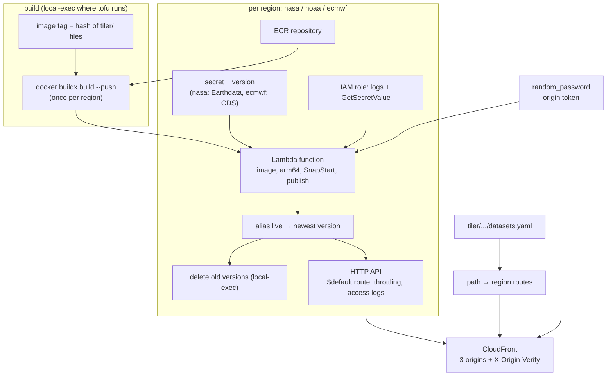

# Infrastructure (`terraform/tiler/`)

An OpenTofu module (OpenTofu ≥ 1.11, `hashicorp/aws ~> 6.0`) that creates
three regional deployments of the tiler image behind one CloudFront
distribution.

| File | What |
|---|---|
| `versions.tf` | Required versions and the provider aliases the caller passes in |
| `variables.tf` | Name prefix, sizing and limits, CORS, price class, secrets |
| `deployments.tf` | ECR repositories, the image tag and build, the three `regional-api` instances |
| `secrets.tf` | Earthdata and CDS secrets, the CloudFront origin token |
| `cloudfront.tf` | The distribution ([CloudFront](./cloudfront)) |
| `outputs.tf` | `url`, `distribution_id`, per-deployment details, one example TileJSON URL per preset |
| `modules/regional-api/` | Lambda function, `live` alias, version pruning, HTTP API |
| `modules/ecr/` | One ECR repository |
| `tests/plan.tftest.hcl` | `tofu test` with mocked providers |
| `examples/test/` | A complete, tagged test deployment |

## Why three regions {#why-three-regions}

::: warning Design decision: deploy next to each data source
- **NASA Earthdata Cloud** is in S3 in **us-west-2**, and NASA only allows
  direct S3 reads from inside that region. From anywhere else every byte
  goes through HTTPS URLs with Earthdata Login redirects, several times
  slower.
- **NOAA GOES** (`noaa-goes19`) is in **us-east-1**.
- **ECMWF's ARCO Zarr** is served from ECMWF's network in Europe.
  **eu-south-1 (Milan)** is the AWS region nearest to ECMWF's Bologna data
  centre, but it must be enabled for the account; eu-central-1 (Frankfurt)
  works without. The caller chooses with the `aws.ecmwf` provider's region;
  `/datasets/{id}/latency` shows whether the choice pays off.

Idle Lambda, API Gateway and Secrets Manager cost little, so the price of
three regions is mostly complexity, which CloudFront hides behind one URL.
One region reading everything would make NASA reads much slower and pay
transfer on every uncached tile.
:::

## A module with the providers passed in

::: code-group
<<< @/../terraform/tiler/versions.tf [versions.tf]
:::

The module declares no providers of its own: the caller passes the default
`aws` (CloudFront, us-east-1) and the aliases `aws.nasa`, `aws.noaa` and
`aws.ecmwf` (`configuration_aliases`). Tags come from the caller's
providers' `default_tags`; the CloudFront comment is `var.name`.
The test deployment shows a complete caller:

::: code-group
<<< @/../terraform/tiler/examples/test/main.tf#providers [examples/test/main.tf#providers]
<<< @/../terraform/tiler/examples/test/main.tf#secret-vars [examples/test/main.tf#secret-vars]
:::

The module call itself passes the four providers, `name`, low API Gateway
limits, `secret_recovery_days = 0` (secrets deleted at once on destroy) and
the three ephemeral secret variables.

::: warning Design decision: the module lives with the code
The image is built from `tiler/` (`app_dir = "${path.module}/../../tiler"`),
and the CloudFront routes come from `tiler/src/ycgs_titiler/datasets.yaml`,
so the code and its infrastructure change together in this repository. The
persistent deployment in `ycgs-aws-infra` is a thin stack that calls
`github.com/ycgs-lab/multi-resolution-new-haven//terraform/tiler?ref=<tag>`
with its own backend and tags; a Git source with `//subdir` downloads the
whole repository, so the relative `app_dir` resolves. Releasing means
tagging this repository and bumping `ref` there.
:::

Most variables are sizing and limits: `lambda_memory` per deployment (3008
MB for NASA, which mosaics HDF5 granules; 2048 MB for the others),
optional `reserved_concurrency` caps, API Gateway throttling (100 requests/s
steady, 200 burst, per region), CORS origins, and the CloudFront price
class (`PriceClass_100`: North America and Europe).

## ECR and the image tag

Lambda only runs images from ECR in its own region, so each deployment has
a repository. They are a separate module because the image tag depends on
the repository URL and the function on the tag.

::: code-group
<<< @/../terraform/tiler/deployments.tf#ecr-repos [deployments.tf#ecr-repos]
<<< @/../terraform/tiler/modules/ecr/main.tf#repository [modules/ecr/main.tf#repository]
<<< @/../terraform/tiler/deployments.tf#image-tag [deployments.tf#image-tag]
:::

Repositories scan on push and keep the 10 most recent images;
`force_delete` allows `tofu destroy` with images present. Tags are
`IMMUTABLE`. The tag is the first 16 hex digits of a SHA-256 over the name
and hash of every file that goes into the image (`src/**` without
`__pycache__`, `pyproject.toml`, `uv.lock`, `Dockerfile`): same files, same
tag, so unchanged code is not rebuilt and the three regions provably run the
same image. Even a comment change under `tiler/src` (such as a region marker
for these docs) gives a new tag, and the next apply rebuilds once.

## Image build inside `tofu apply` {#image-build-inside-tofu-apply}

::: code-group
<<< @/../terraform/tiler/deployments.tf#image-build [deployments.tf#image-build]
:::

For each region, unless the tag is already in that repository: log Docker
in to that region's ECR, then build and push with buildx. The layer cache
makes the second and third builds nearly instant; each push still uploads to
its region. The resource's `output` is the tag, and each function's
`image_uri` references it, so a function is updated only after its push.

::: warning Design decision: a provisioner instead of a CI pipeline
The common practice is to build in CI and pass the tag in; the Terraform
docs call provisioners a last resort because their effects are invisible to
the plan. Here a build inside apply means one command deploys code and
infrastructure, the content-hash tag ties each function version to exact
source files, and there is no second place to keep the tag in sync. Costs:
Docker with buildx and the AWS CLI must be where `tofu` runs (arm64 builds
on x86 need QEMU / binfmt), and a failed push fails the apply (re-running
is safe: the `describe-images` check skips pushed tags). To move to CI,
replace the resource with a tag variable. Alternatives considered: the
`kreuzwerker/docker` provider (a Docker daemon and registry credentials per
region), ECR cross-region replication (OpenTofu cannot wait for it).
:::

## The regional API module

One instance per deployment. Each creates a Lambda function from the image,
a `live` alias and an HTTP API in front of the alias.

::: code-group
<<< @/../terraform/tiler/deployments.tf#nasa [deployments.tf#nasa]
<<< @/../terraform/tiler/deployments.tf#noaa [deployments.tf#noaa]
<<< @/../terraform/tiler/deployments.tf#ecmwf [deployments.tf#ecmwf]
<<< @/../terraform/tiler/deployments.tf#common-env [deployments.tf#common-env]
:::

The NASA instance enables titiler-cmr and direct S3 access to Earthdata
Cloud and reads the Earthdata secret; the ECMWF instance reads the CDS
secret. `YCGS_SECRET_VERSION` is not read by the app: a new secret version
changes the function's configuration, which publishes a new version (and
snapshot) that reads it.

### IAM and GDAL settings <Badge type="tip" text="standard" />

::: code-group
<<< @/../terraform/tiler/modules/regional-api/main.tf#iam [regional-api/main.tf#iam]
<<< @/../terraform/tiler/modules/regional-api/main.tf#gdal-env [regional-api/main.tf#gdal-env]
:::

The role may write to its own log group and read only its own region's
secret. No S3 permissions: the NOAA bucket is public, the CDS store takes an
API key, and Earthdata S3 access uses temporary credentials that
titiler-cmr gets from NASA. The GDAL variables are titiler's and
titiler-cmr's recommended Lambda settings (no directory listing on open,
HTTP/2 multiplexing, merged range requests, a block cache); they affect COG
reads through GDAL (HLS, ASTER, CHIRPS), not the xarray backends.

### The function

::: code-group
<<< @/../terraform/tiler/modules/regional-api/main.tf#lambda [regional-api/main.tf#lambda]
<<< @/../terraform/tiler/modules/regional-api/main.tf#alias [regional-api/main.tf#alias]
:::

- **Memory** buys CPU too: 2–3 GB gives more than one vCPU, which helps
  decompression and reprojection.
- **Timeout 30 s,** API Gateway's maximum for HTTP APIs, so a slow tile
  fails at the same time in both.
- **`reserved_concurrent_executions`:** −1 is unreserved; a cap bounds cost.
- **Logs** as JSON, INFO for the app and WARN for the platform, kept 14 days.

::: warning Design decision: published versions and a `live` alias
SnapStart only applies to *published* versions, never to `$LATEST`. Every
change to the image or configuration publishes a version, `live` is moved
to it, and API Gateway invokes `live`. A manual rollback is pointing `live`
at an older version; the next apply moves it back.
:::

::: danger Workaround: wait for the published version
A published SnapStart version stays `Pending` for a few minutes while its
snapshot is taken, and invoking it fails until then (API Gateway answers
500 at once). OpenTofu does not wait for it, so `terraform_data.version_active`
runs `aws lambda wait published-version-active` and the alias takes the
version from its output. Found by the AWS test deployment
(`scripts/aws-tests/tiler.sh`), where every request failed right after apply.
:::

### Version pruning {#version-pruning}

::: code-group
<<< @/../terraform/tiler/modules/regional-api/main.tf#prune-versions [regional-api/main.tf#prune-versions]
:::

::: warning Design decision: delete old versions with a provisioner
Python SnapStart charges for every cached snapshot, i.e. every published
version while it exists, and OpenTofu does not delete versions it published
before. After the alias moves, a `local-exec` script keeps the newest 3
(`keep_versions`) and deletes the rest, never the one `live` points to
(`awk` rather than `head -n -N`, for macOS). A failure fails the apply after
the function was updated; AWS's alternative, a scheduled cleanup function,
is more moving parts.
:::

### HTTP API <Badge type="tip" text="standard" />

::: code-group
<<< @/../terraform/tiler/modules/regional-api/main.tf#http-api [regional-api/main.tf#http-api]
<<< @/../terraform/tiler/modules/regional-api/main.tf#permission [regional-api/main.tf#permission]
:::

A single `$default` route with an AWS_PROXY integration (payload format
2.0, what Mangum expects) and an auto-deployed `$default` stage with
throttling and JSON access logs. The permission lets this API invoke only
the `live` alias.

## Secrets

| Secret | Region | Contents | Used by |
|---|---|---|---|
| `<name>/earthdata` | `aws.nasa` | `TITILER_CMR_EARTHDATA_USERNAME`, `..._PASSWORD` | titiler-cmr: CMR, Earthdata S3 credentials |
| `<name>/cds` | `aws.ecmwf` | `YCGS_CDS_API_KEY` | the reader, for the ECMWF ARCO store |

Each lives in the region of the function that reads it.

::: code-group
<<< @/../terraform/tiler/variables.tf#secret-vars [variables.tf#secret-vars]
<<< @/../terraform/tiler/secrets.tf#earthdata [secrets.tf#earthdata]
<<< @/../terraform/tiler/secrets.tf#cds [secrets.tf#cds]
:::

::: warning Design decision: ephemeral variables and write-only attributes
OpenTofu normally records every argument in state, and plan files contain
the values too. Here the variables are `ephemeral`, never saved to state or
plan files, and `secret_string_wo` is a *write-only* argument, sent to
Secrets Manager and not stored. `secret_string_wo_version` controls when:
on create and whenever `secrets_version` changes.

- **First apply:** export `TF_VAR_earthdata_username`,
  `TF_VAR_earthdata_password` and `TF_VAR_cds_api_key` for both plan and
  apply (ephemeral values are not saved in a plan file).
- **Later applies:** leave them unset. The variables then encode to JSON
  nulls, but `secret_string_wo_version` is unchanged, so the provider does
  not send them (worth confirming in `tofu plan`: no change to the secret
  version).
- **Rotation:** set the new values and bump `secrets_version`.

A first apply without the variables creates secrets holding nulls; the
handler skips nulls, `/cmr` answers 503 "Earthdata login not configured"
and the ERA5-Land preset 503 for the missing CDS key. The alternative,
empty secrets filled with `aws secretsmanager put-secret-value`, would
publish (and snapshot) the Lambda before the secret exists.
:::

### The CloudFront origin token

::: code-group
<<< @/../terraform/tiler/secrets.tf#origin-token [secrets.tf#origin-token]
:::

A random 40-character value that CloudFront adds to every request to the
APIs (`X-Origin-Verify`); the app rejects requests without it. It is not a
credential (leaking it only allows bypassing the CDN), so it is an ordinary
stored value, used in the CloudFront origins and each function's
environment.

## Plan tests

`tofu test` plans the module with every AWS and random provider mocked
(realistic ARNs where the AWS provider validates them) and the image build
overridden, so no Docker or AWS calls happen. It checks the CloudFront
route table generated from `datasets.yaml`
([CloudFront](./cloudfront#routes-from-the-catalog)), the default origin,
the function names, and that restricting CORS adds `Origin` to the cache
key. A mocked plan proves the configuration is consistent and the derived
values right, not that AWS accepts them.
