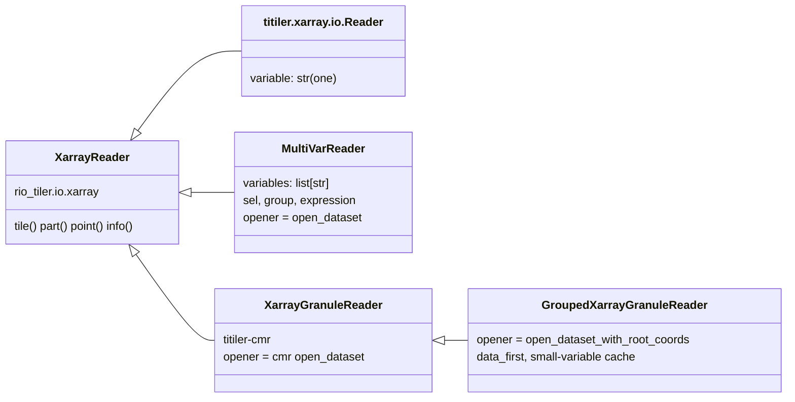

# Readers (`readers.py`)

titiler renders whatever a *reader* gives it: an object with bounds, a CRS
and an array of shape (band, y, x). `readers.py` supplies two readers and
the functions that open data for them:

- **`MultiVarReader`** backs the `/xarray` endpoints (GOES, ERA5-Land). It
  opens a Zarr store or a NetCDF/HDF5 file by URL, lazily, with the right
  credentials; applies `sel` (e.g. a time) to each variable before reading
  any values; stacks variables or time steps into bands `b1..bn`; and
  evaluates an optional expression on them.
- **`GroupedXarrayGranuleReader`** is titiler-cmr's granule reader with a
  different opener, for HDF5 files whose coordinates are not where titiler
  expects them (SMAP, Black Marble). It is described with the other
  [dataset-specific fixes](./fixes).

COGs (`/cog`, HLS and ASTER through titiler-cmr) use rio-tiler's standard
GDAL reader.

::: warning Design decision: our own reader instead of titiler.xarray's
titiler.xarray's `Reader` takes a single `variable`. GOES composites need
three variables from one file, and the ERA5 `diff` render two time steps of
one variable. `MultiVarReader` takes `variables` (a list) and the same `sel`
syntax, following titiler-cmr's convention for several variables, so
expressions look the same on `/xarray` and `/cmr/xarray`.

It imports titiler-cmr's dimension handling (`_arrange_dims`) and lazy
expression evaluator (`apply_expression`), and titiler.xarray's `sel`
parser (`_parse_dsl`) and bucket-region lookup. Names with a leading
underscore are not public API, so an upgrade can break the import; the
tests exercise all of them.
:::

## Opening data

### Constants

::: code-group
<<< @/../tiler/src/ycgs_titiler/readers.py#constants [readers.py#constants]
:::

### The URL allowlist <Badge type="warning" text="decision" /> {#the-url-allowlist}

::: code-group
<<< @/../tiler/src/ycgs_titiler/readers.py#allowlist [readers.py#allowlist]
:::

::: warning Design decision: `/xarray` and `/cog` only open allow-listed URLs
Both take a `url` query parameter. Without a limit, anyone could make the
Lambda fetch arbitrary URLs on our bandwidth: an open proxy. The CDS API key
makes it matter more: it is attached to requests to the CDS host, and the
allowlist keeps user-supplied URLs from using our key for arbitrary data.

The default allows the two NOAA GOES buckets, the CDS ARCO host and the
CHIRPS directory. `YCGS_ALLOWED_URL_PREFIXES` overrides it (the tests add
`file:///`). The CDS prefix still allows *any* store on that host through
`/xarray`; narrow it to the store path if that matters.
:::

### Stores and credentials

::: code-group
<<< @/../tiler/src/ycgs_titiler/readers.py#stores [readers.py#stores]
:::

| URL | [obstore](./glossary#obstore) store | Credentials |
|---|---|---|
| `s3://noaa-*` | `S3Store`, region looked up once per bucket | none: unsigned requests (public bucket) |
| `s3://` (other) | `S3Store` | the Lambda role's, from the environment |
| `https://arco.datastores.ecmwf.int/...` | `HTTPStore` | `Authorization: Bearer <CDS API key>` |
| `https://` (other) | `HTTPStore` | none |
| `file://` | `LocalStore` | local development and tests only |

::: warning Design decision: the CDS key as a default header on one host
The key comes from `YCGS_CDS_API_KEY`, which the Lambda handler loads from
Secrets Manager. It is attached as a default header only for
`arco.datastores.ecmwf.int`, and never appears in a URL, a log line or a
cache key. A missing key raises `MissingCredentials`, returned as HTTP 503.
:::

### Opening and caching

::: code-group
<<< @/../tiler/src/ycgs_titiler/readers.py#open-dataset [readers.py#open-dataset]
:::

- **NetCDF / HDF5** (by file extension) are read through obspec-utils'
  `BlockStoreReader` (4 MB range requests) with the h5netcdf engine, as
  titiler-cmr does; `chunks={}` keeps the variables lazy.
- **Everything else** is opened as Zarr through zarr's `ObjectStore`, as
  titiler.xarray does.
- `fix_goes` returns the dataset unchanged unless it is a GOES file
  ([GOES fixed grid](./fixes#goes-fixed-grid)).

::: warning Design decision: an in-memory LRU of open datasets
Opening is the expensive part: a Zarr store's metadata or an HDF5 header
takes one or more round trips, and neighbouring tiles of one scan or store
come together. The lazy `xarray.Dataset` objects are kept in an LRU keyed by
`(url, group, decode_times)`, 16 entries by default
(`YCGS_DATASET_CACHE_SIZE`), per Lambda execution environment. A lock keeps
two concurrent requests from opening the same file twice (it matters for
local multi-threaded runs; a Lambda environment handles one request at a
time). After a SnapStart restore the caches are emptied, because the
connections they hold may be dead ([Lambda](./lambda#snapstart-hooks)).
:::

## Variables, time steps and bands

### Selecting along dimensions

titiler.xarray's `sel` syntax (`{dim}={value}` or `{dim}={method}::{value}`),
with two differences: a selector for a dimension the variable lacks is
skipped (one `sel` list works for several variables), and the value is cast
to the coordinate's dtype, with a trailing `Z` removed for `datetime64`
(NumPy rejects time zones).

::: code-group
<<< @/../tiler/src/ycgs_titiler/readers.py#select [readers.py#select]
:::

On a lazy dataset `.sel` only narrows an index; titiler reads the pixels of
one tile later, so a time-chunked Zarr store costs one time step's chunks
for the tile's area.

### Stacking into bands

::: code-group
<<< @/../tiler/src/ycgs_titiler/readers.py#get-variables [readers.py#get-variables]
:::

1. **Select, then drop size-one dimensions** (e.g. GOES's scalar band
   coordinate).
2. **One variable:** at most one non-spatial dimension may remain, and it
   becomes the band dimension. That is how **time steps become bands**:
   two `sel=time=...` values give a `(2, y, x)` array, so `diff`'s `b2-b1`
   is "second time minus first time".
3. **Several variables:** each must be 2-D after selection; they are
   concatenated along a new band dimension, in order (GOES composites).
4. **Normalize** to `(band, y, x)` with titiler-cmr's `_arrange_dims`.
5. **CRS** from the variable, else from a grid-mapping variable, else
   EPSG:4326 (as titiler.xarray assumes).
6. **Expression**, if any.
7. **Longitudes** in 0–360 are wrapped to −180–180.

A variable that still has an unselected dimension is an error that says to
add `sel`, rather than silently taking the first element.

::: warning Design decision: time steps and variables share the band mechanism
One expression syntax covers both: `b2-b1` for a temperature change,
`b1;0.45*b1+0.1*b2+0.45*b3;b3` for a synthetic-green true color. A request
cannot mix the two (several variables, each at several times); no preset
needs that.
:::

### Expressions

`apply_expression` (from titiler-cmr) validates the expression's syntax tree
against an allowlist of node types and NumPy functions (`log10`, `sqrt`,
`where`, ...), then evaluates each `;`-separated block on the lazy
`DataArray`s named `b1..bn`. So NISAR's `10*log10(b1/b2)` is computed for
the tile's pixels only, and the rules are identical on `/xarray` and
`/cmr/xarray`.

### The reader class

::: code-group
<<< @/../tiler/src/ycgs_titiler/readers.py#multivar-reader [readers.py#multivar-reader]
:::

An [attrs](https://www.attrs.org/) class, like all rio-tiler readers: it
sets `self.input` to the `(band, y, x)` array, and the parent `XarrayReader`
provides `tile`, `part`, `point` and `info`. `close()` does nothing,
because the dataset is shared through the cache. Its query parameters are
declared in `main.py` ([`MultiVarParams`](./app#backends)).

## Tests

A two-time difference through the real reader, on a synthetic hourly Zarr
store whose values are 290 + hour K: 17:00 − 09:00 = 8 K everywhere (the
09:10 request snaps to 09:00 with `nearest`).

::: code-group
<<< @/../tiler/tests/test_readers.py#two-times [test_readers.py#two-times]
:::
