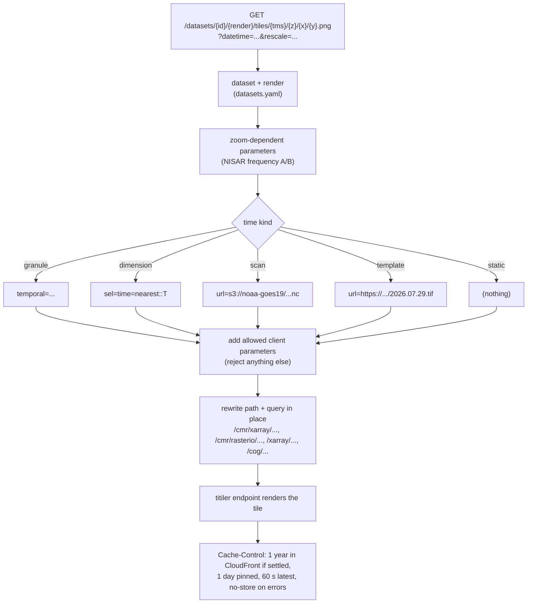

# Request rewriting (`router.py`)

How `/datasets/{id}/{render}/...` requests reach titiler, which parameters
clients may change, and how responses are cached.



## Endpoints

| Path | Served by | Purpose |
|---|---|---|
| `/datasets` | FastAPI route | Catalog summary with links |
| `/datasets/{id}` | FastAPI route | Full preset (renders, time spec, bounds) |
| `/datasets/{id}/times?start=&end=` | FastAPI route | Available times ([listers](./time#choosing-the-lister-for-times)) |
| `/datasets/{id}/latency` | FastAPI route | TCP / TLS connect time from the serving region to the data host |
| `/datasets/{id}/{render}/{tms}/tilejson.json` | FastAPI route | TileJSON whose tile URLs point back at the preset |
| `/datasets/{id}/{render}/tiles/...`, `bbox/...`, `point/...`, `info` | **rewritten** by `PresetMiddleware` | The data, rendered by titiler |

## Why rewrite in-process <Badge type="warning" text="decision" /> {#why-rewrite-in-process}

A preset data request such as

```
/datasets/nisar-gcov/balanced/tiles/WebMercatorQuad/12/1218/1531.png?datetime=2026-07-17
```

is answered by changing the path and query string in the
[ASGI scope](./glossary#asgi) to

```
/cmr/xarray/tiles/WebMercatorQuad/12/1218/1531.png?collection_concept_id=C2854338529-ASF
  &variables=HHHH&variables=HVHV&sort_key=-start_date
  &group=/science/LSAR/GCOV/grids/frequencyA
  &expression=10*log10(b1);10*log10(b2);10*log10(b1/b2)&rescale=-20,0&rescale=-30,5&rescale=2,18
  &temporal=2026-07-17T00:00:01Z/2026-07-17T23:59:59Z
```

and passing it on to the same app, whose router handles it as usual.

::: warning Design decision: an ASGI middleware that rewrites the request
Alternatives:
- **Clients build titiler URLs themselves.** No server code, but collection
  IDs, HDF5 groups, variable names and dB ranges are copied into every
  client, and cache keys depend on how each client spells parameters.
- **A proxy service or HTTP redirects.** A network hop or a round trip per
  tile.
- **Custom endpoints calling titiler's readers.** Duplicates titiler's
  handling of output formats, rescaling, colormaps, masks and errors.

Costs: the rewritten routes are not in the OpenAPI docs (the backend routes
are); it depends on titiler's URL layout (`tiles/...`, `bbox/...`,
`point/...`, `info`); and `resolve` can block (S3 listing for GOES), so it
runs in a worker thread.
:::

## Which paths are rewritten

Only data paths. The other two expressions extract the zoom level from tile
and bbox paths.

::: code-group
<<< @/../tiler/src/ycgs_titiler/router.py#data-route [router.py#data-route]
:::

## What a client may change <Badge type="warning" text="decision" /> {#what-a-client-may-change}

::: code-group
<<< @/../tiler/src/ycgs_titiler/router.py#passthrough [router.py#passthrough]
:::

::: warning Design decision: an allowlist, not a denylist
A client may change output and warping parameters (`tilesize`, `dst_crs`,
`resampling`, `return_mask`, ...), color scaling (`rescale`,
`colormap_name`, `color_formula`), for CMR datasets the granule filters
(`granule_ur`, `cloud_cover`, ...), and on `raw` renders only `variables`
and `assets`. Anything else, such as another `collection_concept_id` or
`url`, gets HTTP 400 with the list of allowed parameters. So the preset URL
space can only read the preset's data, and the CloudFront cache key (the
whole query string) stays small. The generic `/xarray`, `/cog` and `/cmr`
endpoints remain for anything else.
:::

## Zoom-dependent parameters

Some presets choose parameters by zoom (NISAR's HDF5 group). For tiles the
zoom is in the path; a `@2x` tile counts as one level higher. For bbox
requests it is computed from the requested pixel size:
`log2(156543.03 / pixel size)`, where 156543.03 m is the Web Mercator pixel
size at zoom 0. A box in degrees is converted with 111319.49 Web Mercator
meters per degree of longitude, which holds at every latitude because
Mercator stretches latitude, not longitude.

::: code-group
<<< @/../tiler/src/ycgs_titiler/router.py#request-zoom [router.py#request-zoom]
:::

## Resolving a request

`resolve` merges parameters in this order, later ones winning: the
dataset's `params`, the zoom-dependent `params`, the render's `params`, the
time parameters, the client's allowed parameters. It also records whether
the response is **pinned** (fully determined by the URL) and the resolved
time, returned in an `x-ycgs-datetime` header; for scans, the file is in
`x-ycgs-source`.

::: code-group
<<< @/../tiler/src/ycgs_titiler/router.py#resolve [router.py#resolve]
:::

A time-resolution error is a 400 if the client gave a time, and a 404 if
the default failed (e.g. no GOES scan in the last 4 hours).

## The middleware and caching {#caching}

::: code-group
<<< @/../tiler/src/ycgs_titiler/router.py#preset-middleware [router.py#preset-middleware]
:::

It replaces `path`, `raw_path` and `query_string` in a copy of the scope,
and wraps `send` to set headers on the response.

::: warning Design decision: Cache-Control set by the preset layer
- **Settled** (pinned, and the data ended more than the dataset's
  `settled_after_days` ago, or static): `public, max-age=86400,
  s-maxage=31536000` (`YCGS_CACHECONTROL_SETTLED`). CloudFront keeps the
  tile a year (`s-maxage`), so it is rendered once rather than once a day;
  browsers keep it a day (`max-age`), because a CloudFront purge
  ([operations](./operations#purge)) can't reach them.
- **Pinned, not settled** (a recent time, still being ingested, or NISAR,
  which is provisional): `public, max-age=86400`
  (`YCGS_CACHECONTROL_PINNED`).
- **"Latest"** (a scan without `datetime`): `public, max-age=60`; a new GOES
  scan arrives every 5 minutes.
- **Errors:** `no-store`, so a cold-start timeout is not cached.

CloudFront's cache policy follows these values
([CloudFront](./cloudfront#cache-policy)). titiler's default of one hour
applies only to non-preset responses.
:::

## TileJSON

The tile URL template points back at the preset path and carries the
client's query parameters (e.g. `datetime`). Bounds and zoom range come
from the catalog, so building it reads no data.

::: code-group
<<< @/../tiler/src/ycgs_titiler/router.py#tilejson [router.py#tilejson]
:::

The host comes from the `Host` header; behind CloudFront it is restored to
the viewer's host by [EdgeMiddleware](./app#edgemiddleware).

## Latency probe

`/datasets/{id}/latency` measures TCP and TLS connection times from the
region that serves the dataset to its data host. CloudFront routes
`/datasets/{id}/*` to that region, so the numbers reflect the real
deployment, e.g. to compare eu-south-1 with eu-central-1 for ECMWF.

::: code-group
<<< @/../tiler/src/ycgs_titiler/router.py#latency [router.py#latency]
:::

## Tests

::: code-group
<<< @/../tiler/tests/test_presets.py#nisar-zoom [test_presets.py#nisar-zoom]
<<< @/../tiler/tests/test_presets.py#goes-scan [test_presets.py#goes-scan]
:::
