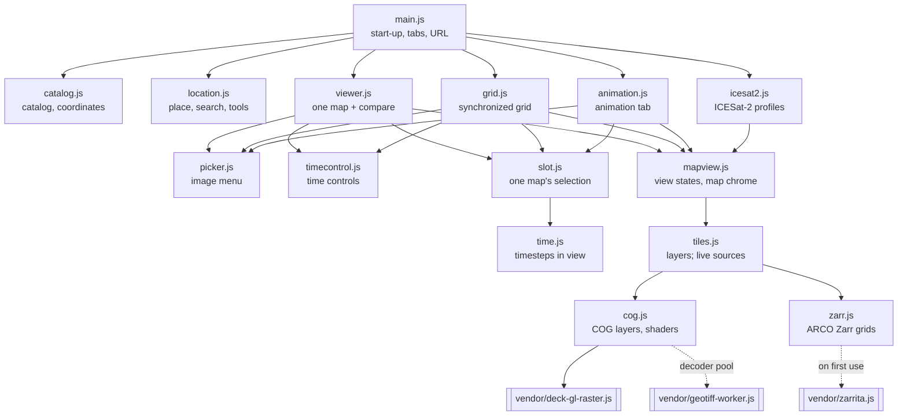
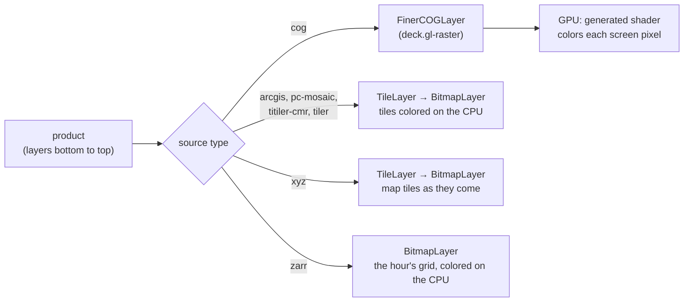
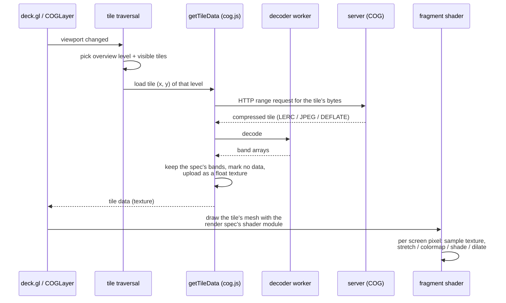

# Map viewer

`website/` is a static site, named **Bowerbird** in its header and page
title: `index.html`, a stylesheet, sixteen ES modules in `js/`, and the
vendored bundles in `vendor/` (deck.gl and deck.gl-raster, the COG decoder
worker, zarrita). There is no server-side code and no build step for the
application code: the browser loads the modules as they are. At start-up it
fetches `env.json` (see [Where the website runs](./time#where-the-website-runs-and-credentials))
and `catalog.json` (see [Website data and the catalog](/pipeline/website-data));
after that it draws every image itself, tile by tile.

## Modules

All map modules import deck.gl from `vendor/deck-gl-raster.js` (deck.gl 9.4
and deck.gl-raster 0.8.1 in one file), and most import `env.js`; only the
main chain is drawn.

| Module | Role | Page |
|---|---|---|
| `main.js` | Loads `env.json` and the catalog, builds the tabs, syncs state with the URL, keyboard shortcuts | [Page, picker and URL state](./page) |
| `env.js` | Where the site runs (`env.json`: cloud or local, service URLs), the user's API keys and the credentials dialog | [Time, live data and credentials](./time#where-the-website-runs-and-credentials) |
| `catalog.js` | The `Catalog` class: product tree, lookups, coordinate conversions | [Catalog and coordinates](./catalog) |
| `location.js` | The selected place, the place search box and the location tools menu | [Place search and location tools](./search) |
| `viewer.js` | The Viewer tab: one map, optional comparison (swipe, opacity, spy) | [Viewer, compare and grid](./viewer-and-grid) |
| `grid.js` | The Grid tab: many maps with shared pan/zoom on one WebGL canvas | [Viewer, compare and grid](./viewer-and-grid#one-canvas-for-the-grid) |
| `animation.js` | The Animation tab: frames loaded ahead of time, played back | [Time, live data and credentials](./time#animation-tab) |
| `icesat2.js` | The ICESat-2 location tool: beam passes on a map and a photon cross-section | [Time, live data and credentials](./time#icesat-2-profiles-a-location-tool) |
| `picker.js` | The searchable image menu | [Page, picker and URL state](./page#the-image-picker) |
| `slot.js` | One map's selection (product, time, options) and why it cannot be shown | [Time, live data and credentials](./time#one-map-s-selection-slot) |
| `timecontrol.js` | The time controls under a map's picker: drop-down, calendar, month grid | [Time, live data and credentials](./time#the-time-control) |
| `time.js` | Timestep keys, and which timesteps have data over the area in view | [Time, live data and credentials](./time#which-timesteps-have-data-in-view) |
| `mapview.js` | View-state conversion, zoom limits, compare-mode props, the place marker, axes, scale bar, colorbars, loading messages | [Map views](./map-views) |
| `tiles.js` | Turns a product into deck.gl layers; image services, tilers and XYZ map tiles | [Image-service layers](./image-services) |
| `cog.js` | COG layers with deck.gl-raster; render spec → shader | [COG layers](./cog-layers) |
| `zarr.js` | ERA5-Land hours read from ARCO Zarr stores with zarrita | [Time, live data and credentials](./time#era5-land-from-an-arco-zarr-store) |

## How a map gets drawn

A product is a list of layers (from the catalog). Each layer becomes one
deck.gl layer, chosen by its source type:

The live sources (ArcGIS ImageServers, Planetary Computer mosaics,
titiler-cmr and this repository's tiler) mostly send raw values: float
images or NumPy (NPY) tiles (NAIP comes as 8-bit images). `tiles.js` colors
them on the CPU with the same render specs and keeps them in one tile cache;
see [Image-service layers](./image-services) and
[Live sources](./time#live-sources).

For a COG, one tile's journey:

## Key design decisions

::: warning Decisions to review
1. **Each product layer is its own deck.gl layer**, composited by the GPU.
   The old renderer composited layers into one bitmap per tile on the CPU.
   → [Views and compositing](/comparison/views)
2. **COGs are read by deck.gl-raster and colored by shaders generated from
   the render specs.** → [COG layers](./cog-layers)
3. **`MapView` for deck.gl, "world" coordinates for everything else.**
   → [Map views](./map-views)
4. **Image services and tilers are read live**, their raw tiles colored on
   the CPU with the same render specs. → [Image-service layers](./image-services)
5. **The grid draws all its maps on one canvas.**
   → [Viewer, compare and grid](./viewer-and-grid#one-canvas-for-the-grid)
6. **All state lives in the URL hash**, so any view can be linked.
   → [Page, picker and URL state](./page#state-in-the-url)
:::

::: tip Standard practice
The rest is ordinary DOM code without a framework: classes that own a piece
of the page, `innerHTML` templates with escaping, event listeners, and a
`requestAnimationFrame` throttle for redraws.
:::
