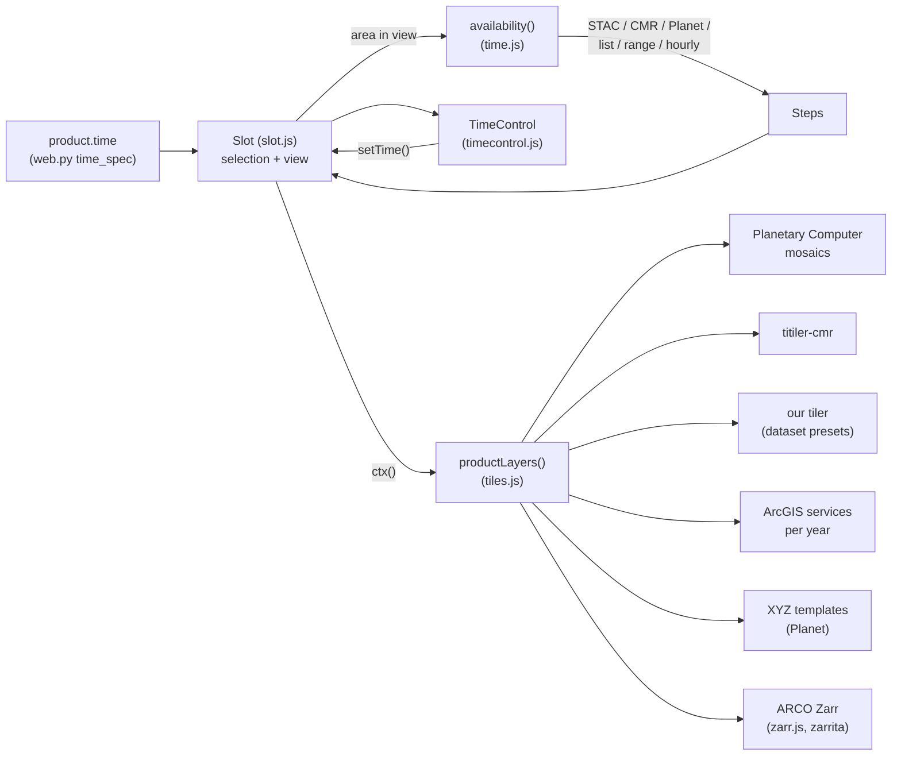

# Time, live data and credentials

Most images change over time. The website lets the user pick a timestep for
every image, reads the data for it straight from the original APIs (no
pre-fetching for those datasets), and says clearly when an image cannot be
shown here and why. This page covers the pieces, from the catalog to the
pixels, and the two tabs built on them: Animation and ICESat-2.

## The time spec

Each dataset's `website-layers.py` (or `create-cog.py`) gives its products a
time spec through `write_spec(..., meta)`; `build_catalog.py` copies the
dataset's `meta` into each product (a product's own keys win), so in the
browser every product has `time`, `requires`, `coverage` and `min_zoom`.

::: code-group
<<< @/../scripts/common/web.py#time-spec [scripts/common/web.py#time-spec]
<<< @/../scripts/common/web.py#requirements [scripts/common/web.py#requirements]
:::

| Dataset | Step | Timesteps from | Widget | Window | Filters | Requires |
|---|---|---|---|---|---|---|
| Landsat 8-9 | day | Planetary Computer STAC | calendar | yes (latest / median / average) | max cloud cover | — |
| NAIP | year | Planetary Computer STAC | drop-down | — | — | — |
| CT orthoimagery | year | fixed list (1934-2023) | drop-down | — | — | — |
| CT lidar | year | fixed list (2016, 2023) | drop-down | — | — | — |
| Planet basemaps | month | Planet Basemaps API | month grid | — | — | Planet key |
| ERA5-Land | hour | the ARCO Zarr store's time axis (1950 to ~5 days ago) | calendar + hour | — | — | CDS key |
| NISAR GCOV | day | CMR | calendar | yes | — | — |
| SMAP L4 (live) | time (3-hourly) | CMR | calendar + time | — | — | cloud |
| Black Marble (live) | year | CMR | drop-down | — | — | cloud |
| GOES LST (live) | hour | every hour since 2025-04-07, to 1 h ago (range) | calendar + hour | — | — | cloud |
| CHIRPS (live) | day | every day since 2000, to 45 days ago (range) | calendar | — | — | cloud |
| Pre-built COGs | one timestep | fixed list of one | label | — | — | — |

Keys are strings that sort in time order: `"2023"`, `"2026-07"`,
`"2026-07-20"`, `"2026-07-20T14:00Z"`.

<<< @/../website/js/time.js#time-keys

## Which timesteps have data in view

`availability(catalog, product, bbox)` lists the timesteps over the area in
view (rounded out a little, so small pans reuse the last answer; cached;
for views larger than 2°, only their central 2° box, so searches stay fast
when zoomed out over a region).
`Steps` is a sorted set with the questions the UI asks (latest, previous /
next with data, days with data in a month, timesteps of a day);
`HourlySteps` answers the same for "every hour" without listing 650 000
hours.

::: code-group
<<< @/../website/js/time.js#availability [availability()]
<<< @/../website/js/time.js#avail-stac [STAC]
<<< @/../website/js/time.js#avail-cmr [CMR]
<<< @/../website/js/time.js#avail-planet [Planet]
<<< @/../website/js/time.js#avail-list [fixed list]
<<< @/../website/js/time.js#avail-range [range]
<<< @/../website/js/time.js#steps [Steps]
:::

A `range` lists nothing: for products with one file per step at a known
place (GOES scans, CHIRPS days) every step from a start date to now minus
the product's latency is assumed to exist.

STAC items keep their properties (e.g. `eo:cloud_cover`), so the filters
(`applyFilters`) apply in the browser without asking again. Max cloud cover
defaults to 20% (scene-wide; slide it to 100% to keep every image).

## One map's selection: Slot

A `Slot` holds one map's product and time selection, the timesteps over its
view, and whether the image can be drawn here at all. Viewer A and B, every
grid slot and the animation each have one.

::: code-group
<<< @/../website/js/slot.js#selection [selection and URL]
<<< @/../website/js/slot.js#slot [Slot]
:::

- **Default: the latest.** A new selection is `auto`: it follows the latest
  timestep with data in view (re-resolved when the view moves), until the
  user picks one; "Latest" switches back to auto. (Hand-picked "Example"
  timesteps for New Haven were dropped in 0.6: they meant nothing elsewhere.
  `@latest` in older links still reads as auto.)
- **Same dataset, same time.** Switching between products of one dataset
  (Landsat true color → urban false color) keeps the date.
- **URL.** `a=landsat/truecolor@2026-06-01..2026-08-31;px=median;cc=30`:
  product, timestep, optional end, and options / filters that differ from
  the defaults.

### Why an image is not drawn

<<< @/../website/js/slot.js#slot-blocker

`status()` adds the time questions: still listing timesteps, no imagery in
view, no imagery on the selected date here ("Timestep not available"). The
maps draw nothing for the slot and show the reason in the middle of the map,
with an "Enter API key" button for locked datasets:

<<< @/../website/js/mapview.js#map-notice

## The time control

<<< @/../website/js/timecontrol.js#tc-build

- **Drop-down** for a few isolated timesteps (survey years, ≤ 40 timesteps
  in view), newest first, with the dataset's labels ("1934: Fairchild Aerial
  Surveys, black and white").
- **Calendar** for many: days with imagery in view are highlighted, the rest
  grayed out; ⏮ / ⏭ jump to the previous / next month with data; months for
  monthly datasets; a time-of-day drop-down when a day has several
  timesteps (hourly, 3-hourly).
- **◀ ▶** step to the previous / next timestep with data in view (also `,` /
  `.` for image A).
- **Advanced** (datasets with a window): an end date (any day up to the
  dataset's limit) and how the images in between are combined: latest,
  median or average pixel. The images are mosaicked by the tiler.
- **Filters** inline, e.g. max cloud cover.
- Hidden while the image cannot be shown at all (locked, cloud only,
  outside its coverage).

<<< @/../website/js/timecontrol.js#calendar

## Live sources

The time context (`slot.ctx()`: timestep, window as ISO times, options,
filters, the timestep's parameters) goes to `productLayers`, which picks
the source by type. All tiled live sources share one renderer interface and
one tile cache, which the animation fills ahead of time.

<<< @/../website/js/tiles.js#tile-cache

### Planetary Computer mosaics

::: code-group
<<< @/../scripts/common/web.py#pc-mosaic-source [web.py]
<<< @/../website/js/tiles.js#pc-register [register]
<<< @/../website/js/tiles.js#pc-tile [tiles]
<<< @/../website/js/tiles.js#parse-npy [NPY]
:::

For each selection a mosaic search is registered once (CQL2: the
collection, the date or window, the filters, the source's own conditions
such as Landsat 8-9 only; newest first, so "first" is the latest pixel).
Tiles are 512 px (`@2x`) NPY arrays of the bands the render spec reads plus
a mask band; the browser applies the scale factors and colors them with the
same CPU code as the ArcGIS tiles. 8-bit imagery (NAIP) comes as PNG.

::: warning Design decision: raw values, colored in the browser
Rendered PNGs from the tiler would be smaller (a 512 px, 3-band Landsat
NPY tile is 2 MB uncompressed), but the render specs (stretches, gamma,
colormaps with under / over colors, expressions) and colorbars would have
to be re-expressed as tiler parameters. Raw tiles keep one rendering path
for every source.
:::

### titiler-cmr (NASA Earthdata)

::: code-group
<<< @/../scripts/common/web.py#titiler-cmr-source [web.py]
<<< @/../website/js/tiles.js#titiler-cmr-tile [tiles]
:::

The service URL comes from `env.json`: `titiler_cmr` is the public NASA
VEDA deployment, which NISAR uses (it works from anywhere, slowly). The
DAACs it cannot read (NSIDC for SMAP, LAADS for Black Marble) go through
this repository's tiler instead.

### This repository's tiler

::: code-group
<<< @/../scripts/common/web.py#tiler-source [web.py]
<<< @/../website/js/tiles.js#tiler-tile [tiles]
:::

The [tiler](/tiler/) (`tiler/`, deployed with `terraform/tiler/`) serves
named dataset presets. The website always asks for a preset's `raw` render
as 512 px NPY tiles and colors them with the same CPU code as the other
raw tiles; `derive` adds bands computed in the browser (GOES LST: the
temperature where the quality flag is 0–1). `time_param` says how the
selected timestep is sent as `datetime`:

- `"instant"`: its start (GOES LST: the scan nearest the hour; CHIRPS: that
  day's file);
- `"interval"`: `start/end`, the granules of that window (SMAP's 3 hours,
  Black Marble's year);
- `None`: nothing (a static dataset).

The service URL is env.json's `tiler`, `null` until a deployment exists, so
these datasets are grayed out with a ☁ icon wherever it is not set. To test
against a local or test deployment, add
`?cloud=1&service.tiler=<url>` to the page URL, e.g.
`?cloud=1&service.tiler=http://localhost:8100` with
`tiler/serve-local.sh` ([running the tiler](/tiler/operations#locally)).

### ArcGIS services per year, XYZ templates

An ArcGIS source's `variants` replace its URL, resolution and band ids for
a timestep (one CT ECO service per flight year). An XYZ URL may contain
`{time:mosaic}` (the timestep's parameter, e.g. Planet's mosaic name) and
`{credential:planet}` (the user's key; never in the catalog).

### ERA5-Land from an ARCO Zarr store

::: code-group
<<< @/../scripts/common/web.py#arco-zarr-source [web.py]
<<< @/../website/js/zarr.js#open-dataset [open]
<<< @/../website/js/zarr.js#zarr-area [area]
<<< @/../website/js/zarr.js#zarr-grids [read]
<<< @/../website/js/zarr.js#byte-lru [chunk cache]
<<< @/../website/js/tiles.js#zarr-layer [layer]
<<< @/../website/js/time.js#avail-zarr [timesteps]
:::

ECMWF publishes ERA5-Land as Analysis-Ready, Cloud-Optimised (ARCO) Zarr
stores, each in two layouts: **geo-chunked** (small areas, long time
series: for a point's history) and **time-chunked** (large areas, few time
steps per chunk: for maps). The website draws maps, so it reads the
time-chunked 2 m temperature store directly from the browser with zarrita
(`website/vendor/zarrita.js`, loaded only when an ERA5 layer is first
shown), with the user's CDS API key as a bearer token (the store's CORS
headers allow it).

- **Time axis from the store:** the timesteps are every step between the
  store's first and last `time` values (read once; regular hourly spacing
  assumed), so "Latest" follows the store's own ~5-day latency.
- **Only the chunks in view:** the read covers the view grown by a quarter
  on each side, snapped to whole degrees (at most 30°); zarrita fetches only
  the chunks that overlap it. Fetched chunks stay in a 400 MB LRU cache, so
  pans and other hours in the same chunks cost nothing.
- **Any layout:** dimension order from `_ARRAY_DIMENSIONS` (v2) or
  `dimension_names` (v3), latitude ascending or descending, longitudes in
  −180..180 or 0..360, CF time units; `scale_factor` / `add_offset` /
  `_FillValue` applied if present (ARCO data are already unpacked).
- **Animation:** all frames are read run by run (one zarrita read per run of
  equally spaced hours), with chunk progress.

ECMWF documents the stores without chunk shapes or codecs; the reader was
tested (values, both latitude orders, Zarr v2 with consolidated metadata and
v3, blosc / zstd, a 401 for a bad key) against mock stores mimicking the
global 0.1° layout, not against ECMWF's store (no key).

## Where the website runs, and credentials

::: code-group
<<< @/../website/js/env.js#load-env [env.json]
<<< @/../website/js/env.js#requirement [requirement()]
<<< @/../website/js/env.js#credentials-store [credentials]
<<< @/../website/js/env.js#credentials-dialog [dialog]
:::

- **Cloud only.** `env.json` `"cloud": "auto"` means: the deployed site (any
  host but localhost) is the cloud; local testing is not. Products with
  `requires.cloud` are grayed out with a ☁ icon locally (and wherever the
  named service is not configured), with the reason as a tooltip. `?cloud=1`
  in the page URL pretends to be in the cloud, and `?service.<name>=<url>`
  sets a service, for testing.
- **Credentials.** The 🔑 Credentials button opens a dialog for the Planet
  and CDS keys. Keys stay in the browser: sessionStorage, or localStorage
  with "Remember", and are only sent to their provider. Products needing a
  missing key are grayed out with a 🔒 icon; picking one opens the dialog.

## Comparing through time

<<< @/../website/js/viewer.js#compare-through-time

Turning Compare on makes B the same image as A one timestep earlier (like
NASA Worldview's comparison), shown with the swipe divider, opacity or the
spy lens; each of A and B has its own time control, and "A, earlier" resets
B that way. The grid's slots each have a time control too, so one image at
several dates can sit side by side.

## Animation tab

::: code-group
<<< @/../website/js/animation.js#anim-frames [frames]
<<< @/../website/js/animation.js#anim-load [Load imagery]
<<< @/../website/js/animation.js#anim-play [play]
<<< @/../website/js/animation.js#anim-handoff [from / to the viewer]
:::

The image travels with the user between the Viewer and the Animation tab:
switching to Animation takes viewer image A (and its filters) and, unless a
date range has been set, starts the range at A's date (~20 timesteps from
it; hourly: that day and the next) on that frame; switching back gives
viewer A the animation's image at the frame shown. Both ways, the other map
takes the same center and zoom (`matchView`).

Pick an image and a start and end date (by default the latest ~20
timesteps in view; for hourly data the last day, every N hours); the frames
are the timesteps with data in view between them, after the filters (at
most 120). **Load imagery** fetches and renders every frame's tiles for the
area in view into the tile cache (six requests at a time, with a progress
bar), as Worldview does; ERA5 frames are read from the Zarr store run by run.
The slider jumps between frames; Play steps through them at 0.5-8 frames
per second, looping or not (space: play / pause, ← →: step). The last fully
loaded frame stays underneath the current one until it has loaded, so
frames never flash to gray. Panning after loading still works (new tiles
load live); the button then offers to reload for the new view. **Cancel**
stops a slow load (requests in flight are aborted; tiles already loaded stay
cached). Under the frame count, a rough estimate of the cache the frames
need: tiles times their rendered size (512 × 512 RGBA, 1 MB, kept in memory),
with a warning when that is more than the tile cache holds (1500 tiles).

## ICESat-2 profiles (a location tool)

Opened from the header's **Location tools** menu, for Greater New Haven
([Location tools](./search#location-tools)).

::: code-group
<<< @/../website/js/icesat2.js#is2-arrow [arrow]
<<< @/../website/js/icesat2.js#is2-profile-events [profile events]
<<< @/../website/js/icesat2.js#is2-profile-draw [profile drawing]
:::

The left map shows the sample beam passes (from `icesat2-profiles.json`,
written by `icesat2/create-cog.py` from the downloaded files; the canopy
height raster is unchanged and can be shown underneath). Clicking a beam
selects it. The right side draws its classified ATL03 photons (elevation
against distance along track, noise and unclassified first) on a canvas.
An arrow on the map (rotated along the track) and a dashed line in the
profile mark the same point: dragging the arrow snaps it to the nearest
point on the track, dragging (or clicking) in the profile moves the line;
each moves the other. The wheel zooms the profile, double-click shows the
whole line. Below the plot: the position, coordinates, and the ground and
canopy-top heights from the photons within ±15 m.
